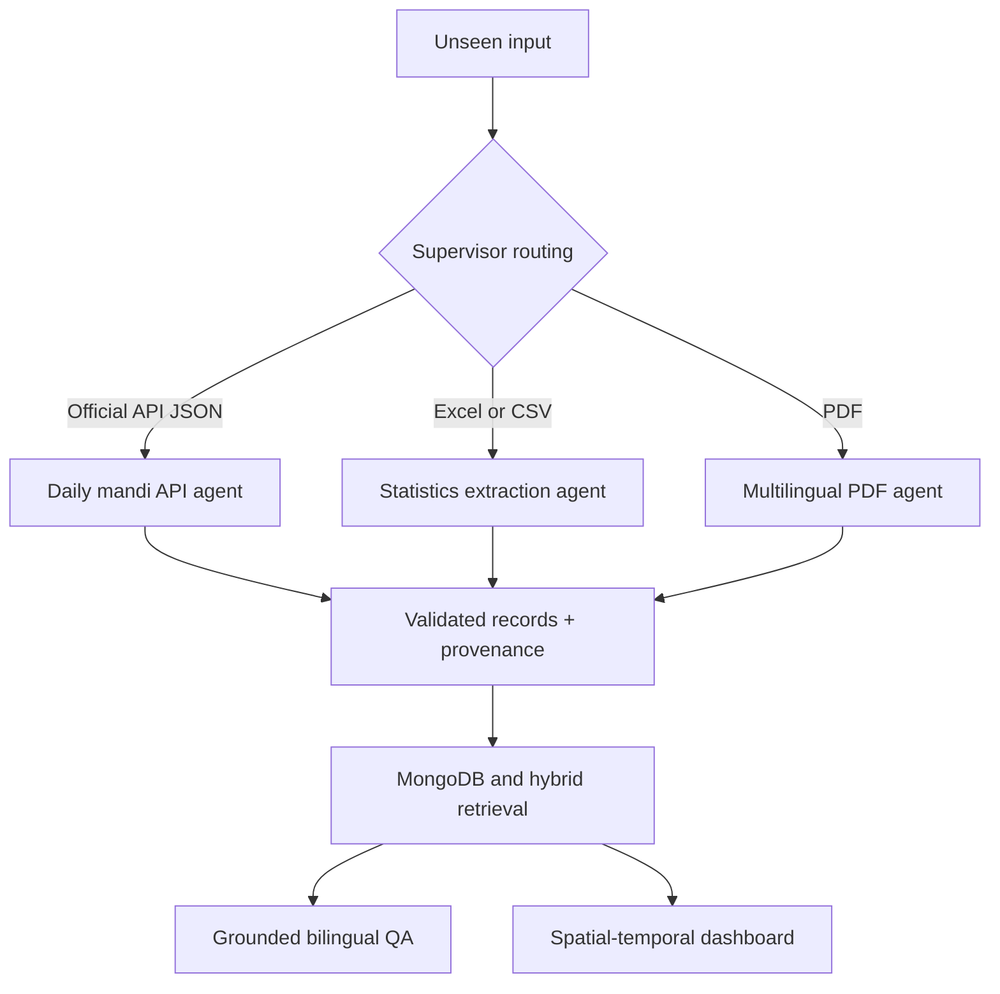

# AgriAgent — CS F407 Artificial Intelligence, Group 17

## Academic Phase II evaluation submission

This section maps the repository to the faculty's Phase II demonstration protocol. Older headings such as “Phase 4” or “Phase 7” below are internal engineering workstream names; they are not claims about the course evaluation stage. The current academic stage is **Phase II evaluation**.

Repository: <https://github.com/flintop123/Bits-AI-Demo>

## Live demonstration

- Public dashboard: <https://p20260108git.github.io/Bits-AI-Demo/>
- Source repository: <https://github.com/flintop123/Bits-AI-Demo>
- Phase II protocol evaluation: **40/40 cases passed**
- Automated regression suite: **198 tests passed**
- Validated database snapshot: **11,912 records**
- Evaluator-style rehearsal: **21/21 checks passed**

The hosted dashboard presents the committed Phase II evidence snapshot. Arbitrary live bilingual questions require the local API, MongoDB, Ollama, and models documented under the clean-clone prerequisites.


## Clean-clone prerequisites (Windows)

The submitted repository is designed to run locally without a paid model API. A
fresh Windows machine requires Python 3.11, Git, Docker Desktop, Ollama,
Tesseract OCR 5.x, and the Chromium browser used by Playwright.

Create the virtual environment and install the Python and browser dependencies:

```powershell
python -m venv .venv
.venv\Scripts\Activate.ps1
python -m pip install --upgrade pip
python -m pip install -r requirements.txt
python -m playwright install chromium
python -m pip check
```

Install Tesseract OCR in its standard Windows location. The extractor
automatically checks `C:\Program Files\Tesseract-OCR\tesseract.exe`; a different
location can be supplied through `TESSERACT_CMD`. Both English and Hindi trained
data are required because scanned documents are processed with `hin+eng`. The
official Hindi model is available from
[`tesseract-ocr/tessdata`](https://github.com/tesseract-ocr/tessdata/raw/main/hin.traineddata)
and should be placed in `C:\Program Files\Tesseract-OCR\tessdata\`.

```powershell
& "C:\Program Files\Tesseract-OCR\tesseract.exe" --version
& "C:\Program Files\Tesseract-OCR\tesseract.exe" --list-langs
python -c "import pytesseract; pytesseract.pytesseract.tesseract_cmd=r'C:\Program Files\Tesseract-OCR\tesseract.exe'; print(pytesseract.get_languages(config=''))"
```

The language checks must include `eng`, `hin`, and `osd`.

Start the submitted MongoDB service. If the named container already exists, use
the first command. If it does not exist, create it once with the second command:

```powershell
docker start bihar-mongodb
# First-time alternative:
docker run -d --name bihar-mongodb -p 127.0.0.1:27017:27017 mongo:7
docker ps --filter "name=bihar-mongodb"
```

Validate the portable database dump and load it into MongoDB when the database
is empty:

```powershell
python db\load_dump.py --validate-only
python db\load_dump.py
```

Install and start Ollama, then make both submitted local-model dependencies
available. `qwen3:4b` performs grounded planning and answer generation;
`bge-m3` supplies multilingual document embeddings.

```powershell
ollama pull qwen3:4b
ollama pull bge-m3
ollama list
curl.exe -sS http://127.0.0.1:11434/api/tags
```

If `ollama` is not on `PATH`, its usual per-user executable can be invoked as
`& "$env:LOCALAPPDATA\Programs\Ollama\ollama.exe"`.

Prepare the checked Hindi evaluation source. The allowlisted command downloads the
official PDF into the Git-ignored `data/pdfs` directory and performs a dry run
without writing to MongoDB:

```powershell
python ingest_agriculture_sources.py --source pmfme_makhana_handbook_hindi --dry-run
python eval\run_eval.py
```

Finally, verify the clean clone before running a demonstration:

```powershell
python -m unittest discover -s tests
python db\load_dump.py --validate-only
git status --short
```
### One-command unseen-file demonstration

```powershell
python run.py --input <file>
```

The command accepts PDF, Excel, CSV and JSON inputs, selects a bounded extractor, writes an auditable JSON trace under `artifacts/phase2/`, and does not write to MongoDB. Use `--force-ocr` only when an unseen scanned PDF requires it.



### Evaluation evidence

- Source inventory and routing: `docs/source_agent_map.csv`
- Per-agent cards: `docs/agents/`
- Challenge and measured experiments: `docs/challenge.md`
- Forty held-out checked cases: `eval/cases/` and `eval/reference/`
- Reproducible evaluator: `python eval/run_eval.py`
- Faculty-format metric sheet: `eval/phase2_metrics.csv`
- Automation log: `logs/automation_log.csv`
- Runtime schema, dictionary and reproducible dump: `db/`
- Honest base/adapter comparison: `eval/adapter_comparison.csv`

M18 is intentionally left pending until the same held-out set has been run against both the base model and a genuine LoRA/QLoRA adapter. The protocol rewards the documented comparison, not an invented positive gain.

Run the CPU-compatible LoRA experiment with `python eval/run_adapter_experiment.py`. It adapts only the QA intent-routing decision using a separate training set and compares the same base checkpoint before and after PEFT LoRA on all ten held-out QA cases. It does **not** claim that the deployed Qwen answer model was fine-tuned.

## Phase 7: spatiotemporal market intelligence

Phase 7 converts the collected mandi history into explainable locality- and
time-aware metrics. For a crop, district, market, or verified coordinate
radius it calculates daily averages, earliest-to-latest change, observed
direction, coefficient-of-variation volatility, two-sigma anomaly flags,
freshness relative to the latest dataset date, and descriptive market ranks.

```text
GET /api/v1/mandi-intelligence?crop=आलू&district=अरवल&days=30
GET /api/v1/mandi-intelligence?crop=आलू&latitude=25.5941&longitude=85.1376&radius_km=75&days=30
```

The dashboard exposes the same calculation with a chart and comparison table.
English and Hindi natural-language questions can route to the deterministic
calculation; Qwen3 explains the returned metrics but does not calculate or
forecast prices. Structured crop, district, and reviewed market filters also
resolve between English and Hindi before querying, and the resolution is
reported in the API response. Crop, district and market dropdowns are populated
from live MongoDB distinct values. Both language label sets are read once from
a persistent cache, so the Hindi/English switch is immediate and also changes
returned comparison labels while preserving official database values. No
filter option is hard-coded in the browser interface. Rebuild the bilingual
cache at any time with `python sync_mandi_catalog_labels.py`. See
`docs/PHASE7_SPATIOTEMPORAL_INTELLIGENCE.md`.

Market names use reviewed aliases or deterministic transliteration; they are
never passed through free-form semantic translation. Reviewed reverse aliases
provide Hindi display labels for official Latin-script market names while the
database values remain unchanged.

## Phase 6: visual analytics dashboard

The browser interface now includes a live MongoDB-backed observability and
market-intelligence dashboard. It visualizes daily collection volume,
geospatial coverage, top crops and districts, data-quality percentages and
recent scheduled-run status without sending analytics data to an external
service.

```powershell
python data_api.py
# Open http://127.0.0.1:5000/
```

The dashboard API is available at `/api/v1/dashboard?days=30`. See
`docs/PHASE6_VISUAL_ANALYTICS.md` for the metric definitions and limitations.

## Phase 5: verified geospatial mandi retrieval

Phase 5 stores conservatively verified market-reference points in a dedicated
`mandi_locations` collection with a MongoDB `2dsphere` index. Recent prices can
then be retrieved by a caller's latitude, longitude and radius while preserving
coordinate source, license, confidence and precision metadata. Each point is
labelled as either a mapped market facility or a market-locality centroid.

```powershell
# Inspect five candidates without writing
python enrich_mandi_locations.py --dry-run --limit 5

# After reviewing the evidence, persist all verified market points
python enrich_mandi_locations.py

# Query recent potato prices near Patna within 75 km
# GET /api/v1/mandi-prices/nearby?latitude=25.5941&longitude=85.1376&radius_km=75&days=7&crop=आलू
```

Ambiguous or mismatched geocoder results remain unresolved; no district
centroids or guessed coordinates are inserted. See
`docs/PHASE5_GEOSPATIAL_MANDI.md` for architecture and verification rules.
The reviewed all-market run verified 42 of 49 observed markets (85.7%) and
intentionally left seven uncertain markets unresolved. Run
`python verify_phase5_geospatial.py` after persistence to verify MongoDB
coverage, required indexes, idempotency and a live nearby-price query.

## Phase 4: daily and locality-aware mandi collection

The Phase 4 pipeline collects official Bihar Krishi mandi observations for an
exact date through the public paginated API, validates the requested temporal
window, preserves official district/market/commodity codes, and performs
duplicate-safe MongoDB upserts with run-level audit evidence.

```powershell
# Validate today's source without changing MongoDB
python run_phase4_mandi_pipeline.py --dry-run

# Collect today's data
python run_phase4_mandi_pipeline.py

# Catch up the latest seven days
python run_phase4_mandi_pipeline.py --days 7
```

The Windows scheduled runner also refreshes this rolling seven-day window on
each daily execution, allowing late source postings and missed runs to be
recovered through duplicate-safe upserts.

Temporal and administrative-locality queries are exposed through
`/api/v1/mandi-prices` and `/api/v1/mandi-prices/trends`. See
`docs/PHASE4_SPATIOTEMPORAL_MANDI.md` for the verified source contract,
architecture, scheduling instructions, and the coordinate-enrichment boundary.

# Data Collection link -
                       - https://statedata.bihar.gov.in/dataLab/
                       - https://www.biharkrishi.in/
                       - https://horticulture.bihar.gov.in/
                       - https://bssca.co.in/SeedReports.aspx

                       - https://appeears.earthdatacloud.nasa.gov/
                       - https://www.earthdata.nasa.gov/data/catalog/lpcloud-mcd12q1-061#documents-and-resources

''' Agriculture information is already existing, such as MODIS LC, GLC and Globcover data sets.'''

# Some link of learing research paper -

### Satellite Data in Agricultural and EnvironmentalEconomics: Theory and Practice -
https://onlinelibrary.wiley.com/doi/epdf/10.1111/agec.70006

### Monitoring Horizontal and Vertical Cropping Pattern and Dynamics in Bihar
 https://www.academia.edu/44745746/Kumar_Jeganathan_2017_MonitoringHorizontalAndVertical_cropping_pattern_ISRS


 # Mongodb
 ''' To start the monogdb in local system, execute the command - sudo systemctl start mongod.
     To check the status use the command -  sudo systemctl status mongod '''

''' To create database in mongodb, run the command - mongosh (It will open mongodb shell)
                                   to show the database - show dbs
                                   To use specific database - use bitsAiDemoForBihar'''


## Running the mandi ingestion on Windows

Start Docker Desktop and ensure the MongoDB container is running:

```powershell
docker start bihar-mongodb
docker ps --filter "name=bihar-mongodb"
```

Activate the Python environment and run ingestion:

```powershell
.\.venv\Scripts\Activate.ps1
python ingest_mandi.py
```

A repeated run should process the available records but insert zero duplicates.

## Phase 2 agent orchestration

The Phase 2 supervisor routes known source types to four specialist agents:
Playwright for mandi data, pandas/openpyxl for Excel statistics, and
pypdf/Tesseract for multilingual PDFs, followed by grounded English/Hindi QA
through MongoDB and the local Ollama model. Each run records tool events,
retries, failure status, automation metrics, and source provenance in MongoDB.

Run a fast, non-writing demonstration and evaluate the observed trajectory:

```powershell
python run_phase2_pipeline.py --source mandi --source crop_statistics --dry-run --trace-out artifacts\phase2\latest_run.json
python evaluate_phase2_agents.py artifacts\phase2\latest_run.json --output artifacts\phase2\latest_evaluation.json
```

See `docs/PHASE2_AGENT_EVALUATION.md` for the architecture, source-to-agent
mapping, evaluation criteria, database fields, limitations, and LangSmith setup.

### Constrained ReAct supervisor (second orchestration path)

The supervisor above is deterministic: the source type is already known
before the run starts. `run_extractor.py` covers the opposite case — a
free-text request where the matching capability isn't known in advance. A
LangChain ReAct agent (Ollama `qwen3:4b`) decides which of four
already-tested capabilities to call, in a Thought/Action/Observation loop,
never gaining any capability beyond those four fixed tools:

```powershell
python run_extractor.py "load last seven days of mandi data via api"
python run_extractor.py "what was total rice production in 2024-25?"
```

Configure the Ollama model and MongoDB connection for this agent in one
place via `.env` (copy `.env.example`); see `agent_config.py`. Run
`python -m unittest tests.test_react_agent` to verify the agent's plumbing
against a scripted fake model, without needing Ollama or MongoDB running.
See `docs/REACT_AGENT.md` for the full design, including which decisions
are made by the model and which by fixed code.

Run the final manifest-driven evaluation across the live mandi source, Excel,
English PDF text extraction, Hindi OCR, English/Hindi grounded QA, and a
transient-failure recovery case:

```powershell
python run_phase2_evaluation_suite.py --output docs/evidence/phase2_final_suite.json
python export_team_contributions.py
```

The suite uses independent expected inputs from
`sources/phase2_evaluation_cases.yaml`; it does not construct its reference
trajectory from the observed tool call.

## Ingesting the crop statistics workbook

The supplied DA&FW workbook contains crop-wise area, production and yield data from 1966-67 to 2024-25. Validate it without changing the database:

```powershell
python ingest_crop_statistics.py --dry-run
```

Load the normalized records into MongoDB:

```powershell
python ingest_crop_statistics.py
```

The records are stored in `bihar_agriculture.crop_statistics`. Repeated runs update existing crop-season-year records without creating duplicates.
## Querying stored agriculture data

The read-only Flask API exposes the mandi prices and normalized crop statistics
stored in MongoDB. Start Docker Desktop, ensure `bihar-mongodb` is running, and
run:

```powershell
python data_api.py
```

Available endpoints:

- `GET /health`
- `GET /api/v1/mandi-prices?limit=10`
- `GET /api/v1/crop-statistics?crop=Rice&year=2024-25&limit=10`
- `GET /api/v1/catalog`

The API binds to `127.0.0.1:5000` by default. Query limits must be between 1
and 100.
## Asking grounded natural-language questions

The `POST /api/v1/ask` endpoint uses the local `qwen3:4b` Ollama model to
convert a natural-language question into an allowlisted query plan. MongoDB is
then queried through the read-only service, and the answer is generated only
from the retrieved records.

Start the API:

```powershell
python data_api.py
```

Example request:

```powershell
$body = @{ question = "What was Rice production in 2024-25?" } | ConvertTo-Json
Invoke-RestMethod -Method Post -Uri "http://127.0.0.1:5000/api/v1/ask" -ContentType "application/json" -Body $body
```

The response includes the answer, interpreted intent and filters, ranked
retrieval candidates in `records`, answer-grounding citations in `sources`,
and the model name. A citation is returned only when its record was inside the
answer-generation evidence boundary. The language model never receives
permission to create arbitrary MongoDB queries.

Generated answers are checked against the requested English or Hindi script. If the local model responds in the wrong language, the service performs one grounded language-correction pass over the same retrieved records without adding new evidence. If that correction still uses the wrong script, a deterministic extractive fallback returns concise text from the ranked source records instead of accepting an unsupported model response.

## Ingesting the official Bihar agriculture PDF

The PDF ingestion command downloads the official Bihar Annual Scheme 2022-23
document and extracts only pages 11-30, which contain the Agriculture and Allied
Sector chapter. Each chunk retains its document title, page number, source URL,
source filename, and content hash.

```powershell
python ingest_agriculture_pdf.py --dry-run
python ingest_agriculture_pdf.py
```

Downloaded PDFs are stored under `data/pdfs/` and are excluded from Git. Repeated
ingestion is duplicate-safe because MongoDB upserts each source/page/chunk identity.

## Searching and asking questions about PDF sources

Search the indexed official document directly:

```text
GET /api/v1/documents/search?q=organic%20farming&limit=5
```

The existing natural-language endpoint also routes scheme, policy, programme,
seed, mechanization, horticulture and similar questions to the PDF collection:

```text
POST /api/v1/ask
{"question": "What does the report say about the organic farming corridor?"}
```

Responses contain the retrieved text, source URL, document title and PDF page
number so that generated answers can be checked against the official source.
## Browser demo

Start MongoDB and ensure the local Qwen model is available, then run:

```powershell
python data_api.py
```

Open `http://127.0.0.1:5000` in a browser. The demo displays collection counts,
accepts natural-language questions, and presents the grounded answer together
with its applied filters, retrieved records, and page-aware source links.

## Multilingual source expansion

The source manifest at `sources/agriculture_sources.yaml` contains an
allowlisted collection of official Bihar and Government of India agriculture
PDFs. It includes English, Hindi, and mixed-language sources. List them with:

```powershell
python ingest_agriculture_sources.py --list-sources
```

Validate extraction without writing to MongoDB:

```powershell
python ingest_agriculture_sources.py --dry-run
```

Ingest all enabled sources and verify duplicate protection by repeating the
same command:

```powershell
python ingest_agriculture_sources.py
python ingest_agriculture_sources.py
```

The extractor first uses the PDF text layer. Pages with missing or unusable
text automatically fall back to local Tesseract OCR with `hin+eng`. Every
stored chunk retains the detected language, extraction method, source
organization, document title, page number and source URL. Original Hindi text
is preserved; it is not replaced by a translation.

Use `--no-ocr` to disable fallback or `--force-ocr` to OCR every selected page.
Downloaded documents and OCR language files are reproducible local artifacts
under `data/` and are excluded from Git.

## Phase 2 database schema and evidence

The formal MongoDB collection contract, identity rules, provenance mapping,
duplicate handling and observed population evidence are documented in
[docs/DATABASE_SCHEMA.md](docs/DATABASE_SCHEMA.md). The machine-readable schema
catalog is stored in
[docs/schema/bihar_agriculture.schema.json](docs/schema/bihar_agriculture.schema.json).

To reproduce the database counts, index inventory and provenance coverage:

    python export_database_evidence.py --run-id 5d062f9d-6f69-42bd-bedb-f7a6b521071f

## Challenge and supporting literature

The project-specific design comparison, measured findings, limitations and references are documented in [Challenge and Supporting Literature](docs/CHALLENGE_AND_LITERATURE.md).

## Phase 3 multilingual hybrid retrieval

Phase 3 combines the existing language-neutral MongoDB keyword search with
local multilingual semantic embeddings. Reciprocal Rank Fusion merges both
rankings, allowing Hindi questions to retrieve relevant English evidence and
English questions to retrieve relevant Hindi evidence. Qwen3 remains the
grounded query-planning and answer-generation model; `bge-m3` is used only for
retrieval embeddings.

Install the local embedding model and build vectors for the current document
chunks:

```powershell
ollama pull bge-m3
python build_document_embeddings.py
```

Repeated indexing skips chunks whose content hash and model are already
current. Force a complete rebuild after changing the embedding model with:

```powershell
python build_document_embeddings.py --rebuild
```

Run the labelled retrieval evaluation:

```powershell
python evaluate_phase3_retrieval.py --output docs/evidence/phase3_hybrid_retrieval.json
```

The browser interface supports automatic, English, or Hindi answer output.
The returned payload reports whether document evidence was found through
keyword, semantic, or hybrid retrieval. See
[docs/PHASE3_HYBRID_RETRIEVAL.md](docs/PHASE3_HYBRID_RETRIEVAL.md) for the
architecture, ranking method, evaluation contract, and scaling boundary.
