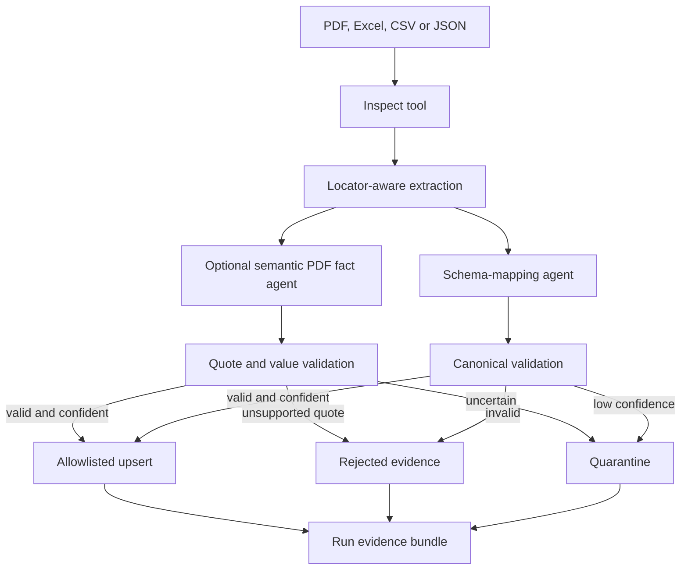

# Agentic ingestion v2

This is an isolated Round 2 implementation. It does not modify `agent.py`,
`run_extractor.py`, or the existing ReAct demonstration.

## Purpose

The Phase II surprise-file entry point proves that a file can be read safely,
but it deliberately does not write to MongoDB. Agentic ingestion v2 adds a
separate path for:

1. structure inspection;
2. provenance-aware extraction;
3. model-proposed schema mapping;
4. deterministic validation;
5. confidence-gated, duplicate-safe persistence; and
6. stage-by-stage audit evidence.

For unfamiliar PDF layouts, an optional semantic document agent also extracts
explicit numeric facts. Every proposed fact must carry a verbatim evidence
quote and is checked against the original page/chunk before it can become a
write-eligible record.

The model never generates or executes MongoDB syntax. It may propose a mapping
only to one of the allowlisted collections. Pydantic models validate the plan
and every output record before the persistence tool can run.

## Execution flow



## Tool contracts

Every agent-visible tool has a versioned input and output JSON Schema in
`ingestion_v2/tool_registry.py`. The LangChain StructuredTool adapters are in
`ingestion_v2/langchain_tools.py`; they are intentionally not imported by the
existing ReAct agent.

Print the contracts without starting Ollama or MongoDB:

```powershell
python run_ingestion_v2.py --print-tool-schemas
```

## Dry run and write mode

Dry run is the default:

```powershell
python run_ingestion_v2.py --input "surprise.xlsx"
```

The local Qwen model inspects a bounded preview and proposes a `MappingPlan`.
The plan is validated and applied to the complete extracted dataset. No record
is written.

MongoDB persistence requires the explicit flag:

```powershell
python run_ingestion_v2.py --input "surprise.xlsx" --write
```

A record must be schema-valid and meet the default mapping-confidence threshold
of 0.85. Invalid records are rejected. Valid records below the threshold are
quarantined from writes.

## Semantic PDF facts

Use the local Qwen model to inspect extracted PDF chunks for explicit numeric
agriculture facts:

```powershell
python run_ingestion_v2.py --input "unfamiliar-report.pdf" --semantic-facts
```

This remains a dry run. To persist both the normal PDF chunks and only the
validated, high-confidence facts:

```powershell
python run_ingestion_v2.py --input "unfamiliar-report.pdf" --semantic-facts --write
```

The agent is bounded to four chunks per model call and defaults to two. The
maximum number of examined chunks can be controlled without changing source
code:

```powershell
python run_ingestion_v2.py --input "unfamiliar-report.pdf" `
  --semantic-facts --max-fact-chunks 20 --fact-batch-size 2
```

Safety rules are enforced after model inference:

- `evidence_quote` must occur in the referenced extracted chunk;
- `value_as_reported` must occur inside that quote and contain a number;
- page, chunk and character offsets come from the extractor, not the model;
- duplicate facts from overlapping chunks are removed;
- low-confidence but otherwise valid facts require human review and are not
  written by the default persistence threshold; and
- the model cannot issue database commands or select an arbitrary collection.

Validated facts are stored in the allowlisted `agriculture_facts` collection,
using `fact_id` as an idempotent identity. The original wording, optional model
normalization, page/chunk locator, extraction model and complete field
provenance are retained.

For a reproducible evaluation, a reviewed plan can be saved and supplied:

```powershell
python run_ingestion_v2.py --input "surprise.xlsx" --plan mapping_plan.json
python run_ingestion_v2.py --input "surprise.xlsx" --plan mapping_plan.json --write
```

## Evidence bundle

Each run creates:

```text
artifacts/ingestion_v2/<run-id>/
    run.json
    events.jsonl
    extraction.json
    mapping.json
    persistence.json
    semantic_facts.json                 # when --semantic-facts is used
    semantic_fact_persistence.json      # when --semantic-facts is used
    evidence_report.json
    evidence_report.html
```

The bundle reports extraction coverage, required-field coverage, validation
rate, inserted/matched/modified counts, rejections, quarantines, tool versions,
and source locators.

The standalone HTML report is designed for evaluator inspection. For every
candidate record, it places the extracted source data, canonical mapping and
MongoDB read-back in adjacent panels. Field lineage expands to show the raw
value, target value, transformation, confidence and exact page/cell/JSONPath.
Extraction success, schema-validation success and persistence success are
reported separately, so text recovery cannot be mistaken for correct storage.

Regenerate a report for an existing run and verify the MongoDB collection:

```powershell
python run_ingestion_v2.py --report-run <run-id> --verify-mongo
```

Open the resulting file in a browser:

```powershell
start artifacts\ingestion_v2\<run-id>\evidence_report.html
```

Compare a failed and corrected run quantitatively:

```powershell
python run_ingestion_v2.py --compare-runs <before-run-id> <after-run-id>
```

This creates `comparison.json` and `comparison.html` under
`artifacts/ingestion_v2/comparisons/`. The report shows extraction,
validation, rejection and persistence results before and after a correction.

Locators are modality-specific:

- PDF: file, URL, page and chunk;
- Excel: file, worksheet, row, column and cell;
- CSV: file, row and column;
- JSON: file and JSONPath.

## Current increment

The foundation supports canonical validation for:

- `agriculture_documents`;
- evidence-anchored `agriculture_facts`;
- `crop_statistics`;
- `mandi_prices`; and
- verified `mandi_locations`.

It also supports wide annual Excel tables by converting period columns into
one canonical record per period. The visual side-by-side inspector is generated
for every CLI run without changing the existing ReAct demonstration.

## Tests

```powershell
python -m unittest tests.test_ingestion_v2 tests.test_semantic_document_facts tests.test_ingestion_evidence_report tests.test_run_ingestion_v2_observability -v
```

The focused suite covers contracts, unknown fields, source locators, wide-table
mapping, validation failure, confidence quarantine, dry-run safety, explicit
writes and evidence generation.
The semantic-document suite additionally covers quote grounding, numeric-value
grounding, hallucination rejection, deduplication, confidence review and the
MongoDB fact identity.
