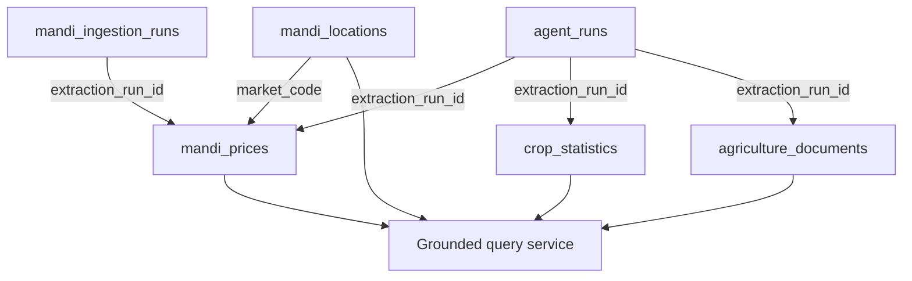

# Bihar Agriculture Database Schema

## 1. Purpose and design

The `bihar_agriculture` MongoDB database stores normalized records from four
different source families and the audit history of the supervisor that invokes
their specialist agents. The design keeps source-specific facts in separate
collections because their identities and intended queries differ. All
orchestrated content records share four provenance fields so that a result can
be traced to the agent and extraction run that produced it.

The machine-readable contract is provided in
[`schema/bihar_agriculture.schema.json`](schema/bihar_agriculture.schema.json).
MongoDB remains flexible for source-specific metadata, while required fields,
identity rules and value normalization are enforced by the extractors,
connectors, unique indexes and automated tests.

MongoDB references are logical rather than embedded foreign keys. The
`agent_runs.run_id` value is copied into each content record as
`extraction_run_id`. This preserves source records independently while making
every Phase 2 write auditable.

## 2. Shared provenance contract

| Field | Type | Rule | Purpose |
| --- | --- | --- | --- |
| `extraction_run_id` | string | Required for orchestrated writes | Links the record to `agent_runs.run_id` |
| `extracting_agent` | string | Required for orchestrated writes | Identifies the specialist agent |
| `source_type` | string | Required | Distinguishes website, Excel and PDF records |
| `extracted_at` | ISO 8601 string | Required for orchestrated writes | Records the UTC extraction time |

The source URL or file, source-specific location, crop/location/time fields and
units remain in the individual collections rather than being collapsed into a
generic document that would be difficult to query.

## 3. Collection schemas

### 3.1 mandi_prices

One document represents one crop-variety observation for a market and date.

| Field group | Fields | Validation and use |
| --- | --- | --- |
| Identity | `district`, `market`, `date`, `crop`, `variety`, `source_url` | Compound unique index prevents duplicate observations |
| Values | `price`, `minimum_price`, `maximum_price` | Numeric when present; extracted from source strings |
| Units | `unit` | Normalized as `quintal` |
| Source | `source_language`, `source_url`, `scraped_at`, `metadata` | Retains Hindi origin, URL and scrape context |
| Provenance | `extraction_run_id`, `extracting_agent`, `source_type`, `extracted_at` | Links the record to the Mandi Web Agent run |

Phase 4 supplements these fields with the official `source_record_id`,
`district_code`, `market_code`, `crop_code`, `variety_code`, arrival quantity,
source epoch timestamps, and the declared market/day spatial and temporal
granularities. The source reuses identifiers on different reporting dates, so
the official identifier and observation date are uniquely indexed together.
The original compound identity remains compatible with browser-ingested
records by appending the optional official identifier to the shared unique
index. Consequently, source-native rows that otherwise have the same visible
market fields remain distinct, while browser rows without an official id stay
duplicate-safe. A locality-time index supports district, market, commodity and
date queries without scanning the full collection.

Expected query dimensions are district, market, crop, variety and date.
Application validation rejects non-object rows and rows missing any of the
eight source-table fields. Dates are normalized from `DD/MM/YYYY` to
`YYYY-MM-DD` where possible. Numeric parsing returns null instead of inventing
a value when the source cell has no parseable number.

### 3.2 mandi_locations

One document represents one conservatively verified geographic point for an
official mandi `market_code`. Coordinates use GeoJSON order
`[longitude, latitude]`. The collection is separate from daily price rows so a
market coordinate is stored once and joined by its stable source code.

| Field group | Fields | Validation and use |
| --- | --- | --- |
| Identity | `market_code` | Unique official market identifier |
| Administrative locality | `market_name`, `district_code`, `district_name` | Links the point to Bihar source labels |
| Geometry | `location`, `location_precision` | GeoJSON Point and an explicit distinction between market facility and locality centroid |
| Verification | `verification_status`, `verification_method`, `confidence` | Only uniquely matched Bihar candidates may be stored |
| Coordinate provenance | `coordinate_source`, `coordinate_source_url`, `coordinate_source_license`, `osm_type`, `osm_id`, `geocoded_at` | Makes the derived coordinate auditable |

Ambiguous, out-of-state, district-mismatched and name-mismatched candidates
remain unresolved and are never converted into approximate district
centroids. This preserves the difference between an observed market location
and an inferred administrative location.

### 3.3 crop_statistics

One document represents a crop-season-financial-year observation.

| Field group | Fields | Validation and use |
| --- | --- | --- |
| Identity | `crop`, `season`, `year` | Compound unique index prevents repeated time-series points |
| Measures | `area_hectares`, `production`, `yield_kg_per_hectare` | Numeric or null; a row with all three absent is skipped |
| Units | `area_unit`, `production_unit`, `yield_unit` | Preserves tonnes and crop-specific bale weights |
| Source | `source`, `source_file`, `source_row` | Traces a value to the workbook row |
| Status | `is_advance_estimate` | True only for the configured latest estimate year |
| Provenance | `extraction_run_id`, `extracting_agent`, `source_type`, `extracted_at` | Links the record to the Excel Agent run |

Seasons are restricted by the extractor to Kharif, Rabi, Summer and Total.
The workbook must contain Area, Production and Yield blocks with common year
columns. Cotton production uses 170 kg bales; jute-family crops use 180 kg
bales; other crops use tonnes.

### 3.4 agriculture_documents

One document represents one bounded, page-aware text chunk from an allowlisted
official PDF.

| Field group | Fields | Validation and use |
| --- | --- | --- |
| Identity | `source_url`, `page_number`, `chunk_index` | Compound unique index prevents duplicate page chunks |
| Content | `content`, `character_count`, `content_hash` | Searchable text plus integrity and size fields |
| Location | `document_title`, `source_file`, `page_number`, `chunk_index` | Supports page-level citation |
| Language | `language`, `declared_language` | Detected and manifest-declared language |
| Extraction | `extraction_method` | Distinguishes `pypdf` from `tesseract_ocr` |
| Source | `source_id`, `source_organization`, `source_url`, `source_type` | Identifies the allowlisted official source |
| Provenance | `extraction_run_id`, `extracting_agent`, `extracted_at` | Links the chunk to the PDF Agent run |
| Semantic retrieval | `embedding`, `embedding_model`, `embedding_dimension`, `embedding_content_hash`, `embedded_at` | Optional Phase 3 vector representation tied to the exact chunk hash |

A language-neutral MongoDB text index covers `content` and `document_title` so
English, Hindi and mixed-language chunks share one search path. Blank pages are
skipped transparently. Page ranges, source identifiers, filenames and required
manifest fields are validated before extraction.

Phase 3 adds an optional normalized multilingual embedding to each chunk. The
`embedding_content_hash` must equal the current `content_hash` before a vector
is used, preventing stale vectors from influencing retrieval after content is
updated. Embedding fields are reproducible derived data and do not alter the
chunk identity or source provenance.

### 3.5 agent_runs

One document represents one supervisor execution.

| Field group | Fields | Validation and use |
| --- | --- | --- |
| Identity | `run_id` | Unique index; referenced by content records |
| Request | `requested_sources`, `dry_run`, `routing_strategy` | Captures the initial execution decision |
| Lifecycle | `status`, `started_at`, `completed_at` | Shows whether the workflow completed or failed |
| Events | `events` | Records agent selection, tool invocation, attempts, results and errors |
| Results | `results` | Stores each specialist agent's structured output |
| Metrics | `automation_metrics` | Stores automation, retry and unnecessary-call counts |
| Tracing | `langsmith` | Records whether cloud tracing was enabled and the project name |

Statuses are `running`, `completed`, `partial_failure` or `failed`. The
supervisor permits one automatic retry and records both transient and permanent
failures instead of suppressing them.

### 3.6 mandi_ingestion_runs

One document represents one scheduled or catch-up Phase 4 collection. It stores
the requested dates, selected API agent and deterministic tool, pagination and
record counts, inserts/matches/modifications, retries, failures, timestamps and
automation rate. This collection separates recurring operational evidence from
the broader Phase 2 evaluation traces while retaining the same auditable event
model.

## 4. Duplicate and update behaviour

All three content connectors use MongoDB upserts against their explicit
identity fields. A repeated extraction therefore updates the current normalized
values and provenance without inserting a duplicate. `ingested_at` is retained
as the first-insert time for Excel and PDF records, while `extracted_at`
identifies the latest orchestrated extraction represented by the record.

The unique-index identities are:

- Mandi: district + market + date + crop + variety + source URL.
- Official Phase 4 mandi API: source record ID + observation date.
- Mandi locations: official market code.
- Crop statistics: crop + season + financial year.
- PDF chunks: source URL + page number + chunk index.
- Agent runs: run ID.

## 5. Missing values and validation

- Required structural fields cause extraction to fail with a named error.
- Missing numeric measures are stored as null; no value is inferred.
- Crop-statistics rows are omitted only when all three measures are absent.
- Blank PDF pages are counted as skipped rather than stored as empty chunks.
- Unusable direct PDF text can fall back to Hindi-English OCR.
- Unsafe or unknown PDF manifest entries are rejected before download.
- Repeated ingestion is tested to confirm stable collection counts.

The present implementation relies on application validation and database
indexes rather than MongoDB collection validators. This permits gradual source
expansion, but schema-contract tests must be updated whenever a stored field or
identity rule changes.

## 6. Agent output to schema mapping

| Agent | Tool output | Destination | Trace fields added |
| --- | --- | --- | --- |
| Mandi Web Agent | Normalized market-price rows | `mandi_prices` | Run ID, agent, website type, extraction time |
| Crop Statistics Excel Agent | Crop-season-year measure rows | `crop_statistics` | Run ID, agent, Excel type, extraction time |
| Multilingual PDF Agent | Page-aware multilingual chunks | `agriculture_documents` | Run ID, agent, PDF type, extraction time |
| Phase 2 Supervisor | Decisions, events, results and metrics | `agent_runs` | Run ID and lifecycle timestamps |

The read-only query service uses allowlisted filters for structured collections
and ranked MongoDB text search for PDF chunks. The grounded QA service receives
only the retrieved records and returns their source metadata with the answer.

## 7. Observed population evidence

The non-dry Phase 2 run `5d062f9d-6f69-42bd-bedb-f7a6b521071f` completed all
three specialist agents automatically with three tool calls and zero retries.
After the run, provenance coverage was:

| Collection | Total records | Records with all provenance fields | Coverage |
| --- | ---: | ---: | ---: |
| `mandi_prices` | 10 | 10 | 100% |
| `crop_statistics` | 4,372 | 4,372 | 100% |
| `agriculture_documents` | 153 | 153 | 100% |

Run `python export_database_evidence.py --run-id
5d062f9d-6f69-42bd-bedb-f7a6b521071f` to reproduce the collection counts,
index inventory, provenance coverage and representative source-location fields.
