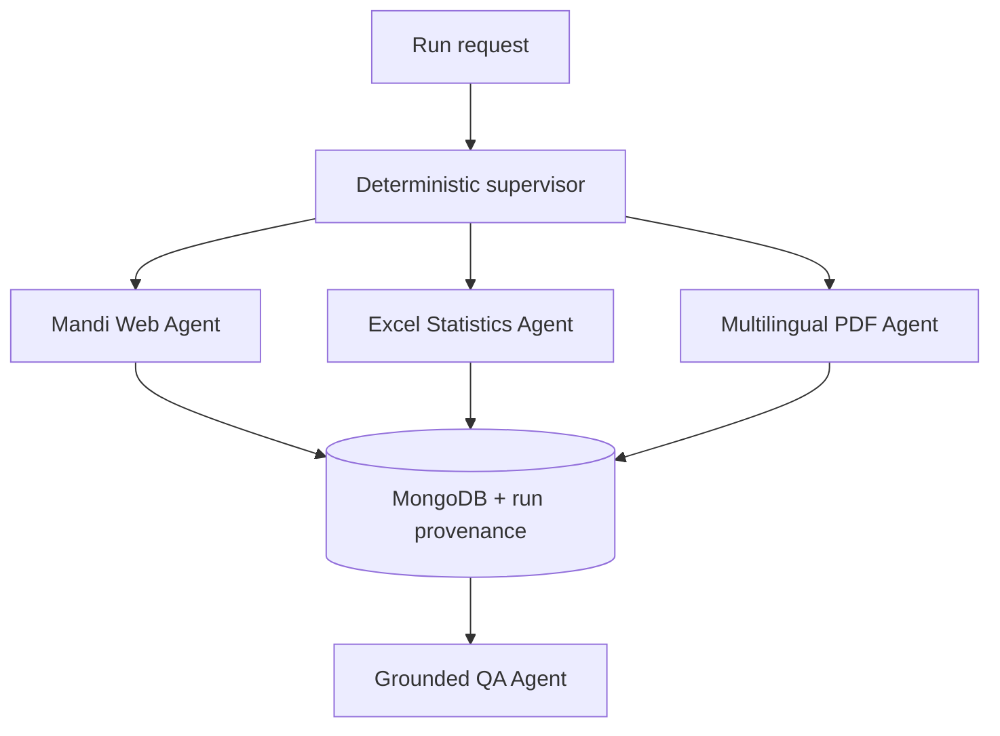

# Phase 2 Agent Orchestration and Evaluation

## 1. Challenge being addressed

Bihar agriculture information is fragmented across a changing Hindi web
table, a multi-decade Excel workbook, and English/Hindi PDF reports. These
sources have different structures, units, languages, and failure modes. The
system therefore uses specialist source agents rather than one unrestricted
agent. Each specialist has one responsibility, a small tool set, deterministic
validation, and a traceable database destination.

The architecture builds on retrieval-augmented generation: first retrieve
evidence, then ask the language model to answer from that evidence. AgentEvals
is used for trajectory evaluation because a correct final answer is not enough;
the selected tool and the intermediate path must also be correct. LangSmith is
used for execution tracing when a project API key is configured.

## 2. Source-to-agent mapping

The machine-readable mapping is in `sources/agent_source_map.yaml`.

| Agent | Source responsibility | Tools/model | Current evidence | Limitation |
|---|---|---|---|---|
| Mandi Web Agent | Bihar Krishi mandi table | Playwright, Python, MongoDB; no LLM | 10 normalized rows in the observed snapshot | Source HTML and availability can change |
| Crop Statistics Agent | Crop-wise area, production, yield workbook | pandas, openpyxl, MongoDB; no LLM | 4,372 records, 36 crop groups, 1966-67 to 2024-25 | Layout-specific parser; latest year is an advance estimate |
| Multilingual PDF Agent | Allowlisted official English/Hindi PDFs | pypdf, Tesseract, PyMuPDF, MongoDB; no LLM | 4 sources, 72/75 pages, 153 chunks | OCR depends on scan quality; 3 pages had no usable extraction |
| Grounded QA Agent | Questions over the three collections | qwen3:4b, allowlisted MongoDB queries | English/Hindi answers with source/page metadata | Limited to indexed evidence and local model capability |

The State Data Lab, additional horticulture endpoints, seed certification
reports, and NASA/MODIS geospatial products are explicitly recorded as pending
in the mapping. They are not presented as completed work.

## 3. Orchestration pattern



The supervisor uses a fixed `source_id -> specialist agent` mapping. An LLM
router was considered but rejected for ingestion because source types are known
before execution; model routing would add cost and nondeterministic failure
without improving extraction. The supervisor records why an agent was selected,
the tool invoked, attempt number, result summary, errors, retries, final status,
and automation metrics. One automatic retry is allowed. Permanent failures are
reported as `failed` or `partial_failure`, never hidden.

## 4. Database traceability

Every newly processed record carries:

- `extraction_run_id`
- `extracting_agent`
- `source_type`
- `extracted_at`

Existing source-specific fields remain: URL/file, source organization, page and
chunk for PDFs, worksheet row for Excel, crop/location/time/units, and extraction
method/language. Unique indexes preserve the source identity and prevent
duplicate inserts. A separate `agent_runs` collection stores supervisor events,
statuses, errors, retries, and automation totals.

## 5. Demonstration procedure

Start MongoDB, activate the virtual environment, and run a fast two-agent demo:

```powershell
docker start bihar-mongodb
python run_phase2_pipeline.py --source mandi --source crop_statistics --dry-run --trace-out artifacts\phase2\latest_run.json
python evaluate_phase2_agents.py artifacts\phase2\latest_run.json --output artifacts\phase2\latest_evaluation.json
```

For a PDF demonstration, add:

```powershell
python run_phase2_pipeline.py --source agriculture_documents --document-source bihar_annual_scheme_2022_23 --dry-run --trace-out artifacts\phase2\pdf_run.json
```

The demo should show input, supervisor selection, tool invocation, tool output,
status, and provenance. A tested difficult case forces a temporary tool failure:
the trace records the error, retries once, and completes. A permanent-failure
test proves that the workflow does not silently claim success.

## 6. Evaluation design

AgentEvals performs strict trajectory matching against the expected specialist
tool path. Code evaluators report results separately for every source agent:

- trajectory/tool-call accuracy;
- tool selection;
- required tool-input fields;
- tool-call success;
- task completion;
- provenance completeness.

These correspond to the Microsoft Foundry evaluator menu items Tool Call
Accuracy, Tool Selection, Tool Input Accuracy, Tool Call Success, and Task
Completion. Groundedness and intent resolution are applied to the QA workflow,
not to deterministic extractors. Safety evaluators are deferred to Phase 3,
when external deployment and broader user inputs are introduced.

The acceptance rule is: all selected agents must pass all six checks. Unit and
integration tests cover normal routing, transient failure/retry, permanent
failure, multilingual OCR, duplicate protection, query filters, API behavior,
and Hindi QA. At this revision, 48 automated tests pass.

## 7. Automation metrics

Every run reports:

- inputs completed without manual intervention / inputs attempted;
- automation rate;
- manual interventions;
- tool calls;
- retries;
- unnecessary tool calls.

For a successful unattended run, the target is 100% automation, zero manual
interventions, and zero unnecessary calls. OCR installation, unavailable source
pages, an absent MongoDB service, or missing LangSmith credentials are reported
as barriers rather than concealed.

## 8. LangSmith use

Tracing is built in but credentials are never committed. Configure them only in
the current terminal:

```powershell
$env:LANGSMITH_TRACING="true"
$env:LANGSMITH_PROJECT="bihar-crop-phase2"
$env:LANGSMITH_API_KEY="YOUR_PRIVATE_KEY"
```

The next orchestration run creates a parent supervisor trace and a child trace
for each selected agent. Without a key, the same run remains fully usable and
explicitly reports that cloud upload was skipped.

## 9. Phase boundary

Phase 2 demonstrates data integration, specialist agents, orchestration,
failure handling, provenance, and evaluation. Phase 3 remains responsible for
full geospatial/satellite integration, deployment hardening, authentication,
scheduled ingestion, broader safety evaluation, and production-scale
monitoring.
