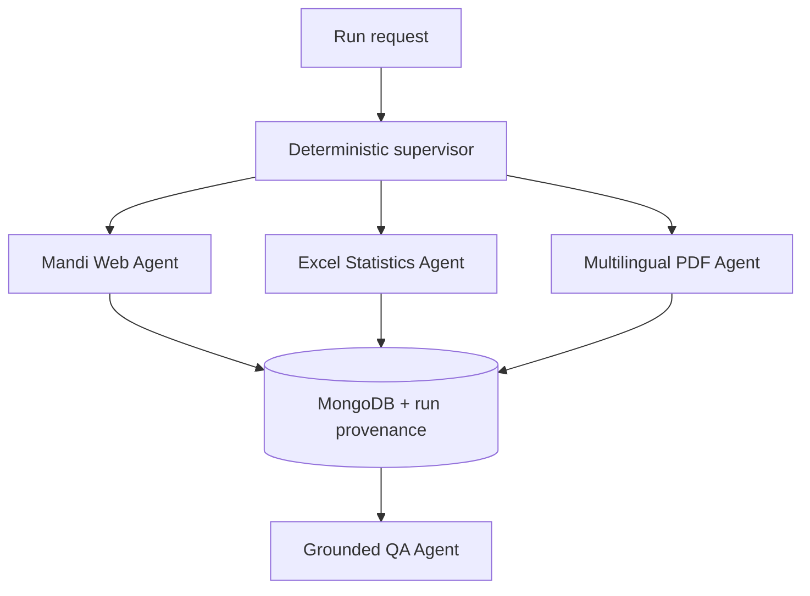

# Phase 2 Agent Orchestration and Evaluation

## 1. Challenge being addressed

Bihar agriculture information is fragmented across a changing Hindi web
table, a multi-decade Excel workbook, and English/Hindi PDF reports. These
sources have different structures, units, languages, and failure modes. The
system therefore uses specialist source agents rather than one unrestricted
agent. Each specialist has one responsibility, a small tool set, deterministic
validation, and a traceable database destination.

The architecture builds on retrieval-augmented generation: first retrieve
evidence, then ask the language model to answer from that evidence. AgentEvals
is used for trajectory evaluation because a correct final answer is not enough;
the selected tool and the intermediate path must also be correct. LangSmith is
used for execution tracing when a project API key is configured.

## 2. Source-to-agent mapping

The machine-readable mapping is in `sources/agent_source_map.yaml`.

| Agent | Source responsibility | Tools/model | Current evidence | Limitation |
|---|---|---|---|---|
| Mandi Web Agent | Bihar Krishi mandi table | Playwright, Python, MongoDB; no LLM | 10 normalized rows in the observed snapshot | Source HTML and availability can change |
| Crop Statistics Agent | Crop-wise area, production, yield workbook | pandas, openpyxl, MongoDB; no LLM | 4,372 records, 36 crop groups, 1966-67 to 2024-25 | Layout-specific parser; latest year is an advance estimate |
| Multilingual PDF Agent | Allowlisted official English/Hindi PDFs | pypdf, Tesseract, PyMuPDF, MongoDB; no LLM | 4 sources, 72/75 pages, 153 chunks | OCR depends on scan quality; 3 pages had no usable extraction |
| Grounded QA Agent | Questions over the three collections | qwen3:4b, allowlisted MongoDB queries | English/Hindi answers with source/page metadata | Limited to indexed evidence and local model capability |

The State Data Lab, additional horticulture endpoints, seed certification
reports, and NASA/MODIS geospatial products are explicitly recorded as pending
in the mapping. They are not presented as completed work.

## 3. Orchestration pattern



The supervisor uses a fixed `source_id -> specialist agent` mapping. An LLM
router was considered but rejected for ingestion because source types are known
before execution; model routing would add cost and nondeterministic failure
without improving extraction. The supervisor records why an agent was selected,
the tool invoked, attempt number, result summary, errors, retries, final status,
and automation metrics. One automatic retry is allowed. Permanent failures are
reported as `failed` or `partial_failure`, never hidden.

## 4. Database traceability

Every newly processed record carries:

- `extraction_run_id`
- `extracting_agent`
- `source_type`
- `extracted_at`

Existing source-specific fields remain: URL/file, source organization, page and
chunk for PDFs, worksheet row for Excel, crop/location/time/units, and extraction
method/language. Unique indexes preserve the source identity and prevent
duplicate inserts. A separate `agent_runs` collection stores supervisor events,
statuses, errors, retries, and automation totals.

## 5. Demonstration procedure

Start MongoDB, activate the virtual environment, and run a fast two-agent demo:

```powershell
docker start bihar-mongodb
python run_phase2_pipeline.py --source mandi --source crop_statistics --dry-run --trace-out artifacts\phase2\latest_run.json
python evaluate_phase2_agents.py artifacts\phase2\latest_run.json --output artifacts\phase2\latest_evaluation.json
```

For a PDF demonstration, add:

```powershell
python run_phase2_pipeline.py --source agriculture_documents --document-source bihar_annual_scheme_2022_23 --dry-run --trace-out artifacts\phase2\pdf_run.json
```

The grounded QA agent can be included in the same supervisor:

```powershell
python run_phase2_pipeline.py --source grounded_qa --qa-question "What was rice production in 2024-25?" --dry-run --trace-out artifacts\phase2\qa_run.json
```

The demo should show input, supervisor selection, tool invocation, tool output,
status, and provenance. A tested difficult case forces a temporary tool failure:
the trace records the error, retries once, and completes. A permanent-failure
test proves that the workflow does not silently claim success.

## 6. Evaluation design

AgentEvals performs strict trajectory matching against the expected specialist
tool path. The final suite reads expected tool arguments from
`sources/phase2_evaluation_cases.yaml`, independently of the observed trace.
This prevents a wrong observed input from being copied into its own reference.
Code evaluators report results separately for every source agent:

- trajectory/tool-call accuracy;
- tool selection;
- required tool-input fields;
- tool-call success;
- task completion;
- provenance completeness.

These correspond to the Microsoft Foundry evaluator menu items Tool Call
Accuracy, Tool Selection, Tool Input Accuracy, Tool Call Success, and Task
Completion. For grounded QA, the suite additionally requires the expected
intent, at least one retrieved record, at least one source, the expected answer
language, and numeric fidelity between the answer and retrieved records. Safety
evaluators are deferred to Phase 3,
when external deployment and broader user inputs are introduced.

The acceptance rule is: every case must pass every applicable check. Unit and
integration tests cover normal routing, transient failure/retry, permanent
failure, multilingual OCR, duplicate protection, query filters, API behavior,
and Hindi QA. At this revision, 63 automated tests pass.

### Final evaluation matrix

| Case | Evidence exercised | Required result |
|---|---|---|
| Live mandi table | Playwright extraction and normalization | Records returned; correct tool/input/provenance |
| Crop statistics workbook | pandas/openpyxl extraction | 4,372 records, 36 crop groups, correct period |
| English official PDF | Direct pypdf text path | Selected source and at least one direct-text page |
| Hindi official PDF | Tesseract `hin+eng` OCR path | Selected source and at least one OCR page |
| English statistics QA | MongoDB retrieval plus Ollama answer | Correct intent/language, sources and numeric fidelity |
| Hindi document QA | Hindi retrieval plus Ollama answer | Correct intent/language and page-aware sources |
| Retry recovery | Injected first-call failure around the real Excel agent | One recorded retry, then normal real-agent output |

Run all seven cases and save the evidence intended for review:

```powershell
python run_phase2_evaluation_suite.py --output docs/evidence/phase2_final_suite.json
```

The command returns a failure exit code unless all seven cases pass.

## 7. Automation metrics

Every run reports:

- inputs completed without manual intervention / inputs attempted;
- automation rate;
- manual interventions;
- tool calls;
- retries;
- unnecessary tool calls.

For a successful unattended run, the target is 100% automation, zero manual
interventions, and zero unnecessary calls. OCR installation, unavailable source
pages, an absent MongoDB service, or missing LangSmith credentials are reported
as barriers rather than concealed.

## 8. LangSmith use

Tracing is built in but credentials are never committed. Configure them only in
the current terminal:

```powershell
$env:LANGSMITH_TRACING="true"
$env:LANGSMITH_PROJECT="bihar-crop-phase2"
$env:LANGSMITH_ENDPOINT="YOUR_REGIONAL_API_ENDPOINT"
$env:LANGSMITH_API_KEY="YOUR_PRIVATE_KEY"
```

Use the API endpoint matching the LangSmith web region: GCP US
`https://api.smith.langchain.com`, GCP EU
`https://eu.api.smith.langchain.com`, GCP APAC
`https://apac.api.smith.langchain.com`, or AWS US
`https://aws.api.smith.langchain.com`.

The next orchestration run creates a parent supervisor trace and a tool-type
child trace for each selected agent. Both levels record structured inputs and
outputs; failed attempts retain their error and retry information. Without a
key, the same run remains fully usable and explicitly reports that cloud upload
was skipped.

## 9. Phase boundary

Phase 2 demonstrates data integration, specialist agents, orchestration,
failure handling, provenance, and evaluation. Phase 3 remains responsible for
full geospatial/satellite integration, deployment hardening, authentication,
scheduled ingestion, broader safety evaluation, and production-scale
monitoring.

## 10. Observed three-agent ingestion evidence

An unattended dry run was completed on 18 October 2026 using the three
implemented ingestion agents. The supervisor routed each source to its fixed
specialist and uploaded the parent and child tool traces to the LangSmith
project bihar-crop-phase2.

- Run ID: 8e0aace2-7c8a-4220-be7b-9b4d64389e0b
- Mandi Web Agent: PASS
- Crop Statistics Excel Agent: PASS
- Multilingual PDF Agent: PASS
- AgentEvals result: 3/3 agents passed; overall PASS
- Automation: 3/3 inputs completed without manual intervention (100 percent)
- Tool calls: 3
- Retries: 0
- Unnecessary tool calls: 0

The reproducible run trace is stored in
[phase2_complete_run.json](evidence/phase2_complete_run.json), and the complete
AgentEvals report is stored in
[phase2_complete_evaluation.json](evidence/phase2_complete_evaluation.json).
LangSmith recorded a supervisor chain plus three child tool runs with structured
inputs and outputs. Access to the cloud trace remains controlled separately by
the LangSmith workspace.

## 11. Team contribution evidence

`python export_team_contributions.py` generates
`docs/TEAM_CONTRIBUTIONS.md` and
`docs/evidence/team_contributions.json` from Git commit authors, subjects, and
changed-file categories. It deliberately labels its scope: committed repository
work is factual evidence, while research, review, presentation, and verbal work
must be explained by the team rather than inferred or fabricated.
