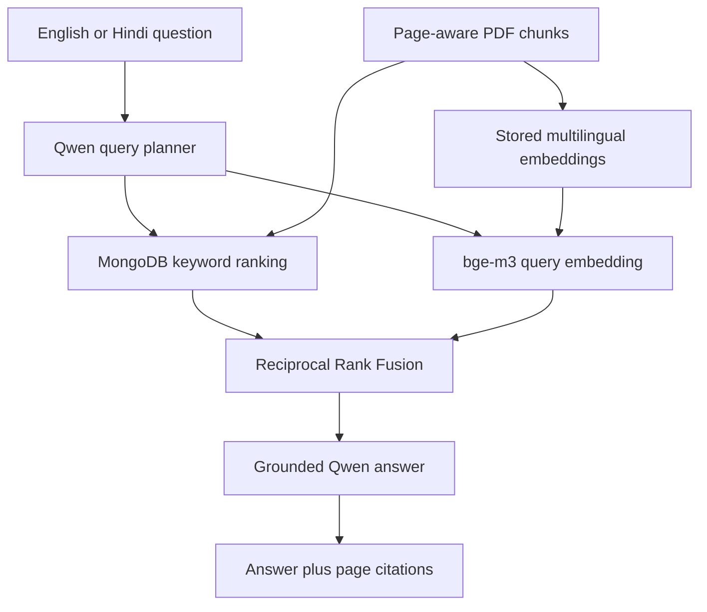

# Phase 3 Multilingual Hybrid Retrieval

## 1. Objective

Phase 2 established format-aware ingestion, multilingual OCR, duplicate-safe
MongoDB storage, provenance, grounded Qwen answers, and repeatable agent
evaluation. Its document search remained lexical: a question could retrieve a
chunk only when MongoDB text search found overlapping words. Phase 3 addresses
that boundary by adding local multilingual semantic retrieval while retaining
the existing keyword path and page-aware citations.

The functional objective is to support four evidence flows:

1. English question to English source;
2. Hindi question to Hindi source;
3. English question to semantically relevant Hindi source; and
4. Hindi question to semantically relevant English source.

The user can independently request an English or Hindi answer. This permits an
English answer to be grounded in Hindi evidence, or a Hindi answer to be
grounded in English evidence, without replacing the original source text.

## 2. Architecture



`qwen3:4b` and `bge-m3` have distinct responsibilities. Qwen produces a safe
query plan and a grounded natural-language answer. BGE-M3 converts queries and
document chunks to normalized vectors so semantically related cross-language
content can be ranked. Both models run through the local Ollama service.

## 3. Index construction

`build_document_embeddings.py` reads the `agriculture_documents` collection
and embeds the document title plus chunk content. Each chunk stores:

| Field | Purpose |
| --- | --- |
| `embedding` | Normalized numeric vector used for cosine similarity |
| `embedding_model` | Model that produced the vector |
| `embedding_dimension` | Validation and audit field |
| `embedding_content_hash` | Content version represented by the vector |
| `embedded_at` | UTC generation time |

Indexing is incremental. A chunk is skipped when its embedding model and
content hash are current. `--rebuild` intentionally regenerates every vector.
During retrieval, a vector is rejected when its stored content hash differs
from the current chunk hash.

## 4. Hybrid ranking

The query service independently produces a keyword ranking and a semantic
cosine-similarity ranking. It then applies Reciprocal Rank Fusion (RRF):

\[
RRF(d)=\sum_{r\in\{keyword,semantic\}}\frac{1}{60+rank_r(d)}
\]

RRF uses position rather than attempting to directly compare MongoDB text
scores with cosine similarity values. A chunk returned by both paths receives
evidence from both rankings. Every returned record exposes its retrieval mode,
contributing methods, component ranks, fused score, and semantic similarity
when applicable.

If the embedding model is unavailable, keyword retrieval remains operational
and the returned retrieval metadata records the semantic warning. This is a
controlled degradation rather than an ungrounded answer path.

## 5. Bilingual grounded answering

The `/api/v1/ask` endpoint accepts `answer_language` as `auto`, `en`, or `hi`.
Automatic mode follows the detected question language. An explicit value
overrides it. The answer prompt states that evidence may be in another language
and permits faithful translation while prohibiting invented facts, units, or
numbers. Existing language validation, one grounded retry, and deterministic
extractive fallback remain in place.

The source response preserves the original document language, organization,
URL, filename, and PDF page. Translation is therefore an answer-presentation
operation and never overwrites the evidence stored in MongoDB.

### Bilingual query expansion

The live browser regression test exposed an important edge case: a concise
Hindi question about the Ganga organic corridor could be semantically closer
to unrelated Hindi makhana passages than to the relevant English report. The
retrieval path therefore adds a small, auditable agriculture glossary before
keyword and semantic ranking. Matching concepts such as `जैविक`/`organic`,
`कॉरिडोर`/`corridor`, and `जिला`/`district` are searched together. This does
not translate or alter stored evidence; it only improves candidate discovery.

For answer generation, the highest-ranked source is treated as the evidence
boundary. Additional chunks may be used only when they belong to that same
source. This prevents a lower-ranked passage in the requested output language
from replacing a more relevant cross-language source during fallback. If the
first grounded answer uses the source language, the correction step translates
that concise answer rather than regenerating from unrelated passages. The
first correction uses a dedicated plain-text Qwen call because a JSON grammar
can cause a small local model to prioritize structural compliance over the
requested script. Before that generative retry, a concise grounded answer in
the opposite language is passed through a dedicated offline MarianMT
English-Hindi model. This separates factual answer generation from language
conversion and avoids relying on prompt compliance for translation. Every
translated or generated text must still pass an independent Devanagari/Latin
language check before it is accepted; otherwise the service continues to the
remaining grounded retries and source-only fallback.

The API deliberately separates retrieval transparency from citation scope.
`records` contains the ranked candidate set and its keyword/semantic scores;
`sources` contains only the pages admitted to the answer-generation evidence
boundary. Consequently, a lower-ranked candidate remains auditable without
being presented to the user as support for an answer it did not ground.

## 6. Evaluation

`sources/phase3_retrieval_cases.yaml` is a labelled bilingual retrieval set.
It includes same-language and cross-language queries with expected source IDs.
`evaluate_phase3_retrieval.py` runs both keyword-only and hybrid retrieval and
reports:

- Hit Rate at 5;
- Mean Reciprocal Rank at 5;
- cross-language hits at 5;
- whether a semantic or hybrid path was actually observed; and
- whether hybrid Hit Rate is at least as high as the keyword baseline.

The committed acceptance contract requires at least 80% hybrid Hit@5 and at
least two cross-language hits. The first live execution should be reviewed
before committing its JSON evidence because OCR or source-content changes can
alter rankings.

`verify_phase3_hindi_corridor.py` additionally executes the exact Hindi
question that revealed the ranking error. It requires the English Bihar annual
scheme source, a Hindi answer containing the documented count of 13 districts,
page-aware citations restricted to the answer evidence, and hybrid retrieval
before it records a pass.

## 7. Operational boundary and future scaling

Exact cosine scoring over 153 chunks is intentionally simple, local, and easy
to audit. It avoids introducing a second database before scale requires one.
If the collection grows to tens of thousands of chunks, the same stored model
and evaluation contract can be migrated to MongoDB Vector Search or a verified
Milvus deployment with an approximate nearest-neighbour index.

Current quality remains bounded by OCR accuracy, the selected embedding model,
the size of the labelled evaluation set, and the local 4B answer model. Phase 3
improves evidence discovery; it does not turn OCR text or generated summaries
into independently verified agronomic advice.

## 8. Reproduction

```powershell
docker start bihar-mongodb
ollama pull bge-m3
python build_document_embeddings.py
python -m unittest discover -s tests -v
python evaluate_phase3_retrieval.py --output docs/evidence/phase3_hybrid_retrieval.json
python verify_phase3_hindi_corridor.py
python data_api.py
```

Open `http://127.0.0.1:5000` and test both answer-language controls after the
evaluation passes.

## References

- BAAI, BGE-M3 model card: https://huggingface.co/BAAI/bge-m3
- Ollama embeddings documentation: https://docs.ollama.com/capabilities/embeddings
- Cormack, Clarke and Buettcher, Reciprocal Rank Fusion:
  https://doi.org/10.1145/1571941.1572114
