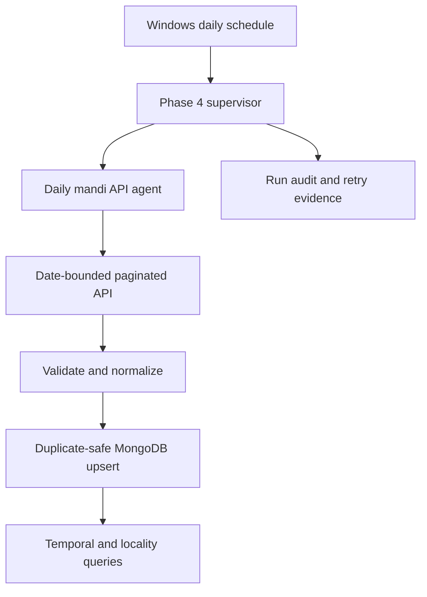

# Phase 4: Scheduled Spatiotemporal Mandi Intelligence

## Objective

Phase 4 operationalizes the faculty requirement to collect mandi data
periodically and make results sensitive to both location and time. It replaces
the ten-row browser-table limitation with the Bihar Krishi public `agriMarket`
API while retaining browser extraction as a fallback and comparison mechanism.

## Verified source contract

The public page calls:

`POST /agent/v1/staticData/_search?service=agriMarket`

The request contains `SearchCriteria` with `pageNo`, `pageSize`, `dateFrom`,
`dateTo`, optional `districtCode`, `marketCenterCode`, and `commodityCode`.
The response contains `Data` and `totalCounts`. The interface permits page
sizes of 10, 25, 50, and 100.

Each official observation includes a stable record identifier, district code,
market code, arrival date, commodity and variety codes, arrival quantity,
minimum price, maximum price, modal price, trend, and source audit timestamps.

## Execution flow



The scheduler determines *when* collection runs. The agent determines *what*
source and deterministic tool are used, validates completion, retries transient
failures, and records evidence. The API client performs the actual network and
pagination operations.

## Stored locality and temporal attributes

Every API observation stores:

- official district name and district code;
- official market name and market code;
- commodity and variety names and codes;
- observation date and source epoch timestamp;
- daily temporal granularity and market spatial granularity;
- arrival quantity, modal/minimum/maximum price, and trend;
- official record id, source URL, extraction run id, agent id, and timestamps.

Administrative locality is therefore deterministic and source-native. A later
coordinate-enrichment step can attach verified market coordinates and a GeoJSON
`location` field without guessing coordinates from names.

## Manual and scheduled execution

Run today's collection without writing:

```powershell
python run_phase4_mandi_pipeline.py --dry-run
```

Write today's observations:

```powershell
python run_phase4_mandi_pipeline.py
```

Backfill seven days:

```powershell
python run_phase4_mandi_pipeline.py --days 7
```

Install the daily task at 08:30:

```powershell
powershell -NoProfile -ExecutionPolicy Bypass -File scripts\install_daily_mandi_task.ps1 -DailyTime "08:30"
```

The scheduled runner refreshes a rolling seven-day window on every execution.
This captures observations posted after an early-morning run, source-side
corrections, and days missed while the workstation was unavailable. Duplicate-
safe upserts prevent repeated records. Operational logs are written under
`artifacts/phase4/scheduled_mandi.log`. Local runtime artifacts remain ignored
by Git; reviewed evidence can be copied into `docs/evidence`.

## Reliability controls

- exact-day API filters prevent accidental ingestion of all 340,000+ records;
- every returned observation is checked against the requested day;
- pagination continues until unique records equal `totalCounts`;
- API and orchestration retries are bounded;
- official id plus observation date, together with the existing business
  identity, protect against duplicates without collapsing different days;
- every live run records dates, attempts, pages, counts, inserts, matches,
  modifications, failures, and automation rate;
- the daily runner automatically refreshes seven days to recover late postings,
  source corrections, and missed scheduled runs.

## Remaining geospatial enhancement

District and market identifiers provide administrative locality immediately.
True distance-based queries require a reviewed market-coordinate reference.
The next increment should ingest verified latitude/longitude for each official
market code, create a MongoDB `2dsphere` index, and add radius-based ranking.
Coordinates must not be inferred or committed without source verification.
