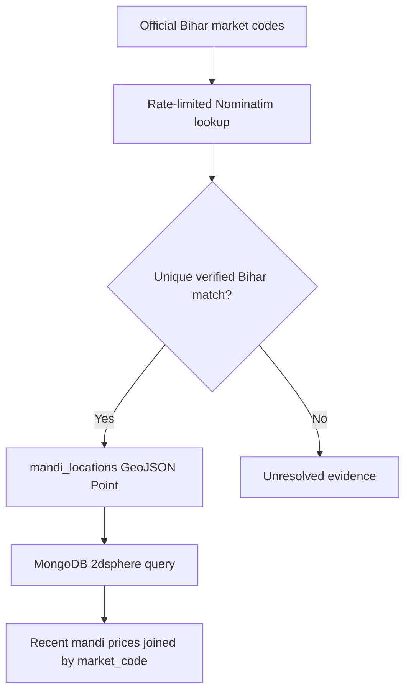

# Phase 5: verified geospatial mandi intelligence

## Objective

Phase 5 adds true distance-aware market retrieval to the temporal and
administrative locality support delivered in Phase 4. A caller can provide a
latitude, longitude and radius and receive recent crop-price observations only
from verified mandi points inside that radius.

## Evidence boundary

The official Bihar Krishi mandi API provides stable market and district codes,
but its observed price payload and lookup responses do not provide latitude or
longitude. Coordinates are therefore derived separately through the public
OpenStreetMap Nominatim search service and are never represented as facts from
the Bihar price API.

The enrichment process follows these safeguards:

1. send at most one uncached request per second with an application user agent;
2. cache raw results locally to avoid repeated requests;
3. require the point to fall inside Bihar and identify Bihar as its state;
4. reject an explicit district mismatch;
5. require a strong market-name match;
6. reject close competing candidates as ambiguous; and
7. allow close duplicate candidates only when their names agree and their
   points are within five kilometres of the same locality; and
8. store the source, license, confidence, precision, OSM identity and time.

An unresolved market remains unresolved. The pipeline does not substitute a
district centroid or fabricate a coordinate. When the source identifies a
mandi only by a town name, the stored point is explicitly labelled
`market_locality_centroid`; it is not claimed to be the market gate. A point is
labelled `market_facility` only when the geocoder identifies a marketplace.

## Architecture



Daily price observations remain in `mandi_prices`; stable locations are stored
once in `mandi_locations`. This avoids copying the same coordinate into every
day/crop/variety observation.

## Commands

Run a small validation without writing coordinates:

```powershell
python enrich_mandi_locations.py --dry-run --limit 5
```

Review `docs/evidence/phase5_mandi_geocoding.json`, then enrich all uniquely
verified observed markets:

```powershell
python enrich_mandi_locations.py
```

Raw Nominatim responses are cached under
`artifacts/phase5/nominatim_cache.json`, which is operational data and is not
committed.

## Reviewed coverage result

The corrected all-market dry run on 18 October 2026 reviewed every market code
observed in the 90-day mandi dataset. It verified 42 of 49 markets (85.7%) and
left seven unresolved. All 42 accepted coordinates are labelled
`market_locality_centroid`; the system does not claim that they identify a
physical market gate.

| Result | Count |
| --- | ---: |
| Observed unique markets | 49 |
| Conservatively verified | 42 |
| Unresolved and not guessed | 7 |

The unresolved markets are `Samastipur APMC`, `कैमूर`, `टेकारी`, `बहादुरपुर
(एकमी घाट)`, `मधुबन (नया)`, `भगवानपुर मंडी (नई)`, and `सैदपुरहाट`. In
particular, the similarly named Bhagwanpur candidate in Vaishali was rejected
because the official market belongs to Muzaffarpur. This is a deliberate data
quality outcome rather than missing-error concealment.

After the dry-run evidence has been reviewed, the controlled finalization flow
writes the 42 verified points, repeats the operation to prove duplicate safety,
checks the unique and `2dsphere` indexes, and executes a real radius query:

```powershell
python enrich_mandi_locations.py --refresh --output docs\evidence\phase5_all_markets_live_write.json
python enrich_mandi_locations.py --output docs\evidence\phase5_all_markets_duplicate_check.json
python verify_phase5_geospatial.py
```

The consolidated verification is stored in
`docs/evidence/phase5_geospatial_final_summary.json`.

## Nearby-price API

Start the existing service and query a radius in kilometres:

```text
GET /api/v1/mandi-prices/nearby?latitude=25.5941&longitude=85.1376&radius_km=75&days=7&crop=आलू&limit=20
```

The result contains:

- the caller's origin as a GeoJSON point;
- distance in kilometres for every price row;
- the verified market GeoJSON point;
- coordinate source, license and confidence; and
- observations from the latest available seven-day data window.

The endpoint accepts a 1-300 km radius, a 1-365 day window and up to 100
records. GeoJSON always stores longitude before latitude.

## Limitations and future work

- Nominatim is a secondary community-maintained source, not the Bihar price
  publisher. A future official mandi-coordinate registry should supersede it.
- Some Hindi market names may remain unresolved or ambiguous. They require
  human review with documentary evidence before insertion.
- Locality-centroid distance supports locality-aware discovery but should not
  be interpreted as road distance to a physical mandi entrance.
- Distance is straight-line spherical distance, not road travel time.
- The current endpoint accepts coordinates. A consent-aware device-location UI
  and a map view can be added without changing the database model.
