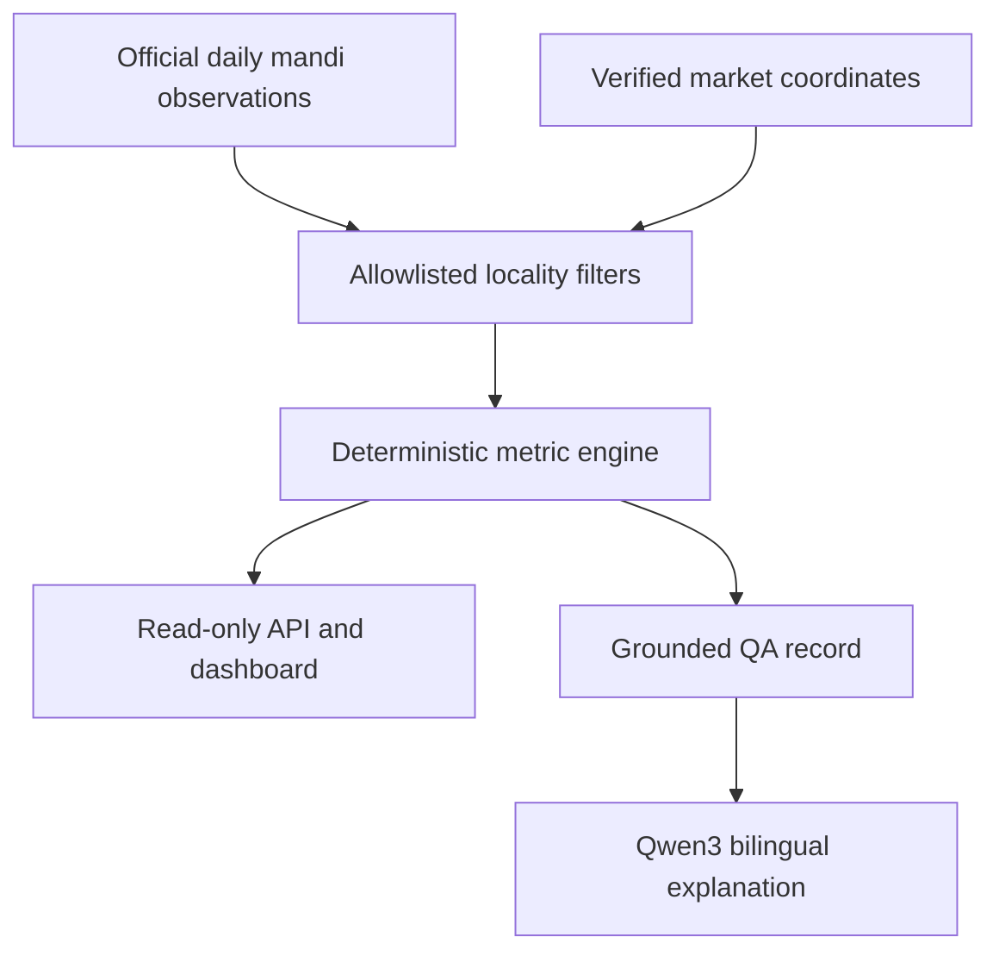

# Phase 7: spatiotemporal market intelligence

## Purpose

Phase 7 answers the practical question: **how are observed mandi prices moving
for a crop in a selected place and time window?** It builds on daily collection
(Phase 4), verified coordinates (Phase 5), and the live visual dashboard
(Phase 6). It does not forecast prices or recommend where a farmer should sell.

## Functional scope

- Filter by crop and optionally district, market, or variety.
- Select a trailing 7, 30, 60, or 90-day window (API supports 1–365 days).
- Optionally restrict analysis to verified markets within a coordinate radius.
- Plot daily average modal prices and observation coverage.
- Compare markets by latest observed average and show distance when applicable.
- Report freshness relative to the latest official dataset date.
- Flag statistically unusual daily averages using a documented rule.
- Answer English or Hindi questions about trend, change, volatility,
  comparison, or anomalies using the same deterministic result.
- Resolve English and Hindi crop, district, and reviewed market aliases against
  the live MongoDB catalogue before querying. Unlisted terms can use the
  existing offline Marian translation model, but are accepted only when the
  translation matches an actual catalogue value.
- Populate crop, district and market selectors from MongoDB distinct values,
  not from HTML or JavaScript lists. Users can switch every selector and
  returned comparison label between Hindi and English without changing the
  underlying official database value.

## Processing boundary



MongoDB supplies observations and verified locality references. Python
calculates every numerical metric. Qwen3 receives the finished calculation and
is instructed to preserve numbers exactly; it is not used as a calculator.

## Metric definitions

| Metric | Definition |
|---|---|
| Window | Trailing calendar days ending on the latest matching observation |
| Daily average | Arithmetic mean of modal prices for the matching day |
| Change | Latest daily average minus earliest daily average |
| Change percent | Change divided by earliest daily average, multiplied by 100 |
| Direction | Rising above +0.5%, falling below −0.5%, otherwise stable |
| Volatility | Population standard deviation of daily averages divided by their mean |
| Anomaly | Absolute daily-average z-score ≥ 2.0, only with at least five dates |
| Freshness lag | Matching latest date minus the overall official dataset latest date |
| Market rank | Descending latest observed average; descriptive only |

The endpoint returns the complete daily series, comparison records,
methodology, source URLs, and calculation scope for auditability.

## API

```text
GET /api/v1/mandi-intelligence
```

Parameters:

- `crop`, `district`, `market`, `variety`: optional allowlisted text filters.
- `days`: integer from 1 to 365; default 30.
- `latitude` and `longitude`: optional coordinate pair.
- `radius_km`: 1 to 300 when coordinates are supplied; default 75.
- `display_language`: `en` or `hi`; controls returned display labels while
  retaining the official fields for traceability.

Latitude and longitude must be supplied together. Nearby scope uses only
`verification_status=verified` entries through MongoDB's `2dsphere` index.
Unresolved markets are never assigned guessed coordinates.

## Natural-language QA

The structured query plan adds a `mandi_intelligence` intent and explicit
metrics for trend, change, volatility, comparison, and anomaly. Examples:

- `How did potato prices change in Arwal over the last 30 days?`
- `Which observed market had the highest recent onion price near Patna?`
- `पिछले 30 दिनों में अरवल में आलू के भाव में क्या बदलाव आया?`

The response is grounded in the returned intelligence object. A rank describes
observed data and must not be presented as a recommendation or prediction.

## Bilingual filter resolution

Structured dashboard and API filters pass through a safe normalization layer.
Exact catalogue matches are preferred, followed by audited bilingual aliases
and then offline English-Hindi translation. A translated candidate never
becomes a database filter unless it matches a value already present in the
live catalogue. The response includes `requested_filters`, resolved `filters`,
and `filter_resolution` evidence. Thus `Potato` can resolve to `आलू`, while an
unknown term remains unresolved rather than being guessed.

## Fast database-driven bilingual selectors

The market-intelligence interface calls `GET /api/v1/catalog?language=all`
once. Crop, district and market option values are the current distinct values
in `mandi_prices`. No filter option is declared in HTML or JavaScript, so newly
ingested values become available after a catalog refresh.

Both labels are downloaded together and retained in browser memory. Changing
the selector therefore updates the three dropdowns and already-rendered market
comparison rows immediately, without another network request or model call.
The API also returns `market_label`, `district_label` and `display_filters` for
non-browser clients.

Reviewed bilingual aliases are preferred; remaining crop and district labels
are translated locally in a MarianMT batch. They are persisted in the
`mandi_catalog_labels` MongoDB collection, so an API restart does not repeat
model loading. `sync_mandi_catalog_labels.py` precomputes the cache, and the
scheduled daily ingestion refreshes it after collecting a rolling seven-day
window. The official source value always remains the query key and is never
overwritten by translated presentation text.

Market names are handled more conservatively than crop names. Because a market
is a proper noun, MarianMT is never used as an English label generator for it.
The system uses an evidence-backed alias where available and otherwise applies
deterministic phonetic transliteration. This prevents a short place name from
being expanded into an unrelated English sentence. Versioned label policy
metadata causes older cached market labels to be regenerated automatically.
An official Latin-script market name can likewise use a reviewed Hindi display
alias; for example, `Samastipur APMC` is shown as `समस्तीपुर एपीएमसी` without
changing its database identity.

## Safety and interpretation limits

- Market coverage varies by day; a change in participating markets can affect
  a statewide or district average.
- Modal prices are observations, not guaranteed transaction prices.
- A two-sigma flag is a screening signal, not proof of bad data or manipulation.
- Locality-centroid distance is approximate and not a road-travel distance.
- No weather, transport cost, quality grade, arrivals, or demand forecast is
  included in the current model.
- Forecasting should be added only after longer history, backtesting, drift
  monitoring, and uncertainty intervals are available.

## Verification

```powershell
python -m unittest discover -s tests -v
python verify_phase7_intelligence.py --output docs\evidence\phase7_spatiotemporal_intelligence_smoke.json
```

The verifier is read-only. It selects an observed crop from MongoDB, executes
the live deterministic calculation, checks metric consistency, validates the
HTTP endpoint, proves that both dropdown-language views contain exactly the
live database crop set, and records evidence without modifying any collection.
